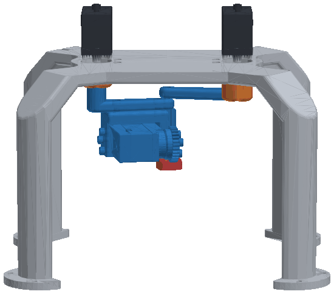
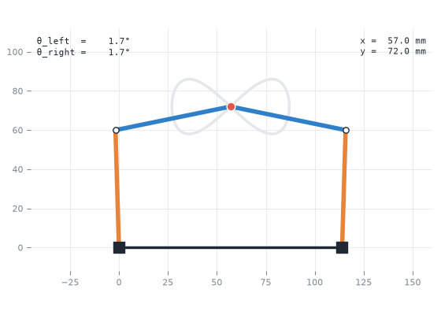
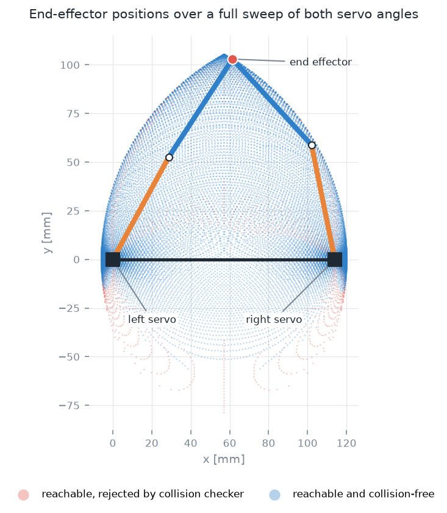
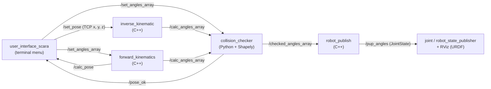

# Double SCARA Robot – ROS Kinematics, Collision Checking & RViz Simulation

A ROS (Melodic) control stack for a **double SCARA robot**: a planar five-bar parallel linkage driven by two servos, plus a Z axis with a pusher.
It covers forward and inverse kinematics, a geometric collision checker, a terminal user interface, live RViz visualisation from a URDF model, and an Arduino `rosserial` bridge to the real Makeblock smart servos.

<p align="center">
  <br>
  <sub>The CAD model in motion: the two servos (black) on top drive the five-bar linkage underneath, which traces a figure-eight while the pusher taps.</sub>
</p>

<p align="center">
  
  
</p>

<sub>Left: the end effector follows a figure-eight. Joint angles come from inverse kinematics, and the pose is drawn with the forward kinematics in this repo. Right: every end-effector position reachable over a full sweep of both servo angles, coloured by the collision model in <code>collision_checker.py</code>. Arm lengths L0 = 114 mm and L1 = L2 = 60 mm are taken from the code.</sub>

---

## Highlights

- **Closed-chain kinematics:** forward and inverse kinematics for a five-bar linkage, solved with the law of cosines. Both nodes also publish the passive elbow angles, so the URDF can display the closed loop.
- **Collision checking:** the arm and the opposite joint are modelled as 2D polygons (Shapely). Unsafe angle pairs are blocked before they reach the robot.
- **Simulation first:** a URDF exported from the SolidWorks CAD model (STL meshes) is animated in RViz through `joint_state_publisher` / `robot_state_publisher`.
- **Hardware bridge:** an Arduino Mega / Makeblock Me Auriga sketch subscribes to joint targets over `rosserial` and drives two MS-12A smart servos.
- **One launch file** starts the whole pipeline.

## System architecture



The angle message is a `std_msgs/Float64MultiArray` with this layout:

| Index | Meaning |
|---|---|
| 0, 1 | Servo angles θ0 (left) and θ1 (right), in the XY plane |
| 2 | Z-axis angle (rack and pinion, r = 14 mm) |
| 3, 4 | Passive elbow angles θ3, θ4 (used only by the simulation) |

## Repository layout

```
src/
├── user_interface_scara/   # terminal UI + double_scara.launch + RViz config
├── inverse_kinematic/      # package MMR_Mech_Double_Scara_Invers: TCP pose -> joint angles
├── forward_kinematics/     # joint angles -> TCP pose (+ passive elbow angles)
├── collision_checker/      # Shapely-based self-collision test
├── robot_publish/          # checked angles -> sensor_msgs/JointState
├── robot_files/            # URDF, STL meshes, display/gazebo launch files
└── arduino_rosserial/      # Arduino sketch for the physical servos
docs/
├── images/                 # figures used in this README
└── tools/                  # scripts that regenerate those figures
```

## Getting started

Tested with ROS Melodic on Ubuntu 18.04.

```bash
# dependencies
sudo apt install ros-melodic-joint-state-publisher ros-melodic-robot-state-publisher ros-melodic-rviz ros-melodic-xacro
sudo apt install ros-melodic-rosserial ros-melodic-rosserial-arduino python-pip
pip install shapely

# build
git clone https://github.com/Abdulhamid-Baghdadi/double-scara-robot-ros.git
cd double-scara-robot-ros
catkin build          # or: catkin_make
source devel/setup.bash

# run the full simulation (the UI opens in its own gnome-terminal)
roslaunch user_interface_scara double_scara.launch
```

Choose **1** in the terminal UI to enter a TCP position (mm), or **2** to enter motor angles (degrees). The robot moves in RViz only if the collision checker accepts the pose.

**With the real robot**, flash `src/arduino_rosserial/arduino_rosserial.ino` to the Arduino Mega / Me Auriga and start the serial bridge:

```bash
rosrun rosserial_python serial_node.py /dev/ttyACM0
```

Each package also has a `readme.txt` with `rostopic pub` commands for testing that node on its own.

## Team & my contribution

University group project in robotics and mechatronics (course *MMR*, winter term 2020/21).

**My part (Abdulhamid Baghdadi):** the URDF robot model and RViz set-up, the forward-kinematics node, the Shapely collision checker, the Arduino `rosserial` bridge, the inverse-kinematics corrections (Feb 2021), and setting up the repository.
Teammates led the inverse-kinematics node, the terminal user interface and `robot_publish`.

## Known limitations

- The inverse kinematics uses `atan` instead of `atan2` in two places and clamps out-of-range cosine values, so poses near the edge of the workspace can come out slightly wrong. The figures above use an independent closed-form solution.
- Link lengths are hard-coded in each node. Moving them to ROS parameters is the natural next step.

## Regenerating the figures

```bash
pip install numpy matplotlib numpy-stl shapely pillow
python docs/tools/scara_plots.py docs/images
python docs/tools/render_urdf.py src/robot_files/urdf/robot_files.urdf src/robot_files/meshes render.png "$(python docs/tools/fk.py -0.5 -0.2)" -50 -100
```
